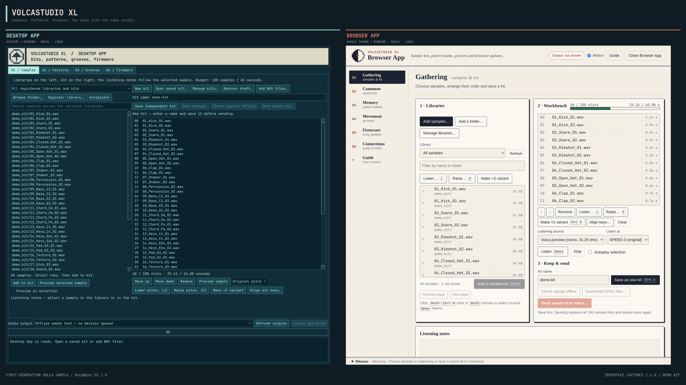

# VolcaStudio XL

Samples, pattern banks, groove templates and firmware for the **first-generation
Korg Volca Sample**, by [DataBeat — Michele Ibba](https://micheledatabeat.github.io/).

Choose WAV files, arrange and transpose them, save a kit, then send it to the
instrument. You can also back up patterns, apply grooves or install DataBeat OS.

**[Download VolcaStudio XL](https://micheledatabeat.github.io/volcastudio-xl-releases/)**
· [quick start](https://micheledatabeat.github.io/volcastudio-xl-releases/docs/browser-quick-start.html)
· [guida rapida](https://micheledatabeat.github.io/volcastudio-xl-releases/docs/browser-quick-start.it.html)
· [release notes](https://github.com/MicheleDataBeat/volcastudio-xl-releases/releases).

## Choose an edition

| Edition | How you use it | Systems |
| --- | --- | --- |
| **Browser App** | A locally installed application that opens in Google Chrome | Windows 10/11 x64, macOS on Apple silicon, Linux x86-64 |
| **Desktop App** | A native desktop window | Windows 10/11 x64, macOS on Apple silicon, Linux x86-64 |

The editions share libraries, kits, pattern banks and firmware on one computer.
Each edition keeps its own audio and MIDI device choices.

Studio contains no firmware. You download the official Korg updater, and Studio
builds DataBeat OS 1.0 from it on your computer (see [Firmware](#firmware)).

## What you can do

- **Build kits:** up to 100 samples within the Volca's approximately 65-second
  budget. Listen, reorder, save and send independent sample copies.
- **Tune samples:** enter varispeed shifts in semitones, or align several
  samples to a reference sample’s pitch class. Review the proposed changes and final kit size.
- **Manage patterns:** save audio backups, restore selected memories or create
  neutral patterns, retaining DataBeat OS's Predictability, motion and timing.
  Patterns use the **DataBeat OS 1.0 pattern format**.
- **Apply grooves:** 270 templates covering 217 timing profiles — MPC3000,
  Dilla-inspired instrument grids, analytical swings and D'Angelo selections.
  Apply them per part to one, several or all pattern memories; only the
  microtiming changes.
- **Install firmware:** build DataBeat OS 1.0 from the Korg updater you
  downloaded, install it, or restore Korg's firmware 1.42. Choose
  **Firmware** in either edition.

Sample transfers work with SYRO-compatible firmware. Pattern and groove features
require DataBeat OS. Volca Sample 2 is not supported.

## Install and open

**Browser App:** download the package for your computer, extract it and open
**VolcaStudio XL Browser App**. The helper opens the workspace in Google Chrome.
Install Chrome separately; no Python, terminal or account is needed.

**Desktop App:** download, extract and open **VolcaStudio XL Desktop App**.

On macOS, move the extracted app to **Applications**. Packages are unsigned.
If your system blocks opening, first verify the download against its release’s
`SHA256SUMS`. For a copy you trust, Windows offers **More info → Run anyway**;
macOS offers **System Settings → Privacy & Security → Open Anyway**. Apply an
exception only to that application.
Mac builds support Apple silicon. Linux desktop packages require glibc 2.35+.
Updating the app keeps your Studio library and settings.

## Firmware

Studio contains no firmware: neither Korg's firmware nor a ready-made DataBeat
OS updater.

1. **Download the Korg updater.** Open Korg's
   [volca sample download page](https://www.korg.com/us/support/download/software/0/370/1475/),
   read Korg's licence agreement and download **System Updater 1.42**:
   `volcasample_updater_1_42.zip`. Keep the zip unchanged.
2. **Add it to Studio.** Browser App: **Firmware → Choose the Korg 1.42 updater…**;
   Desktop App: **04 / Firmware → Add Korg 1.42 updater…**.
   Studio builds DataBeat OS 1.0 and checks the result. It then lists
   **DataBeat OS 1.0** and **Korg volca sample 1.42**.
3. **Install.** Connect the transfer output to **SYNC IN**, power the Volca on
   holding **FUNC + PLAY** until it shows **UPdt**, select the image and follow
   the guided update. Wait for **End** on the Volca. At startup the display
   scrolls **dAtAbEAt OS**.

**Returning to Korg? Use MEMORY + PLAY at startup.** Select the original
**Korg volca sample 1.42** updater in Studio and follow the
[return procedure](https://micheledatabeat.github.io/volcastudio-xl-releases/docs/return-to-korg.html). Keep a backup of your DataBeat OS
patterns first; no intermediate firmware or factory reset is needed.

The [firmware guide](https://micheledatabeat.github.io/volcastudio-xl-releases/docs/firmware.html)
has checksums and details; the
[DataBeat OS manual](https://micheledatabeat.github.io/volcastudio-xl-releases/docs/databeat-os.html)
describes the firmware's pages and controls.

## Connect the Volca

For sample, pattern, groove and firmware transfers, connect the chosen computer
audio output to the Volca's **SYNC IN** with a 3.5 mm cable. Pause other audio
and notifications while transferring. Firmware and SYRO audio are data signals;
never audition them through speakers or headphones.

For **pattern audio backup**, also connect a USB-MIDI output to **MIDI IN** and
the Volca's headphone output to a computer audio input. Other transfers use audio.

**Signals sent** means the computer finished sending. The SYNC IN connection
carries no acknowledgement back to Studio: check the Volca to confirm receipt.
Pattern backups contain patterns, not sample audio or all GLOBAL settings.

## Downloads and help

The [download page](https://micheledatabeat.github.io/volcastudio-xl-releases/)
suggests a Browser App package for your operating system and lists every edition.
Check its CPU architecture and system requirements before downloading.
Each release includes `SHA256SUMS` to verify its downloads.

- [Browser App quick start](https://micheledatabeat.github.io/volcastudio-xl-releases/docs/browser-quick-start.html) · [Italiano](https://micheledatabeat.github.io/volcastudio-xl-releases/docs/browser-quick-start.it.html).
- [Browser App guide](https://micheledatabeat.github.io/volcastudio-xl-releases/docs/browser.html).
- [Desktop App guide](https://micheledatabeat.github.io/volcastudio-xl-releases/docs/desktop.html).
- [Firmware guide](https://micheledatabeat.github.io/volcastudio-xl-releases/docs/firmware.html).
- [DataBeat OS manual](https://micheledatabeat.github.io/volcastudio-xl-releases/docs/databeat-os.html).
- [Release notes](https://github.com/MicheleDataBeat/volcastudio-xl-releases/releases).

## Credits and licences

VolcaStudio XL's own code, documentation and groove catalog are released under
the [MIT License](LICENSE). Korg's SYRO SDK keeps BSD-3-Clause. Bundled runtimes
keep their own terms. Studio contains no Korg firmware: the Korg updater you
download stays under Korg's licence agreement. **DataBeat OS keeps its own
terms**; Studio's MIT licence does not cover the firmware or its patch data. See
[third-party notices](THIRD_PARTY.md) and the notices included in each package.

Groove source credits: Samples From Mars, Kit Maker and pATCHES. The catalog
contains timing offsets, not their audio or MIDI files.

Copyright © 2026 Michele Ibba. An independent DataBeat project, not affiliated
with Korg.
